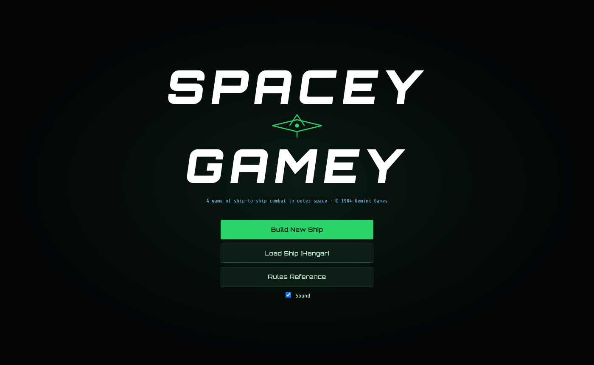
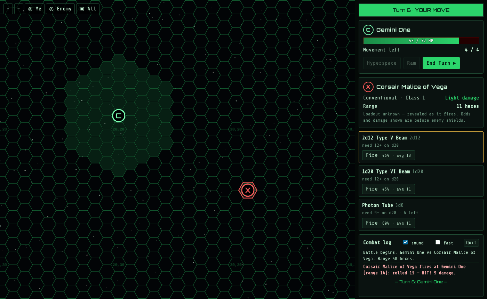
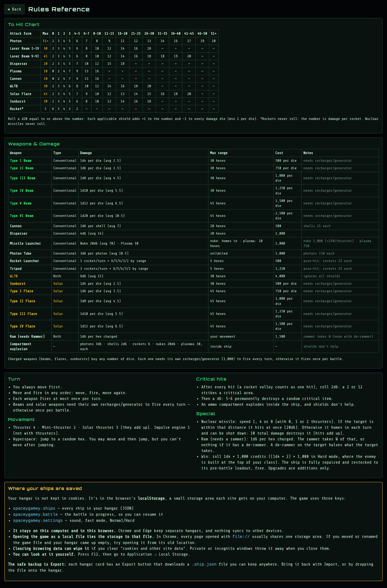

# Spacey Gamey — HTML Edition

A one-player browser version of *Spacey Gamey* (© 1984 Gemini Games), built from `SPEC.md`.



## Play
Open **`Play-Spacey-Gamey.html`** (a copy of `dist/index.html`; the top-level `index.html` is only for `npm run dev`) in a browser (double-click works in Chrome, Edge or Firefox). Everything is in that one file.
Ships you save go in the browser's storage on your device. Use **Export** in the Hangar to keep a `.ship.json` backup, or to move a ship to another computer.

**Controls:** click a green hex to move · Fire buttons on the weapon cards (hover a card to see its range ring) · drag to pan, mouse wheel or pinch to zoom ·
`Space` = End Turn · `H` = Hyperspace · `1–9` = fire the Nth ready weapon. Tick "fast" in the log panel to speed up animations.

## Screenshots

**Battle:** your ship (C) and the enemy (X) on the 50×50 hex grid. The green hexes show where you can move this turn. Each Fire button shows the hit chance and average damage at the current range.



**Rules reference:** the To Hit chart, the weapons and damage table, and the turn, movement and critical-hit rules. See also [`rule-changes.txt`](rule-changes.txt) for every change from the original 1984 rules.



## Develop
```
npm install
npm run dev      # live dev server
npm test         # rules engine tests (to-hit chart vs rulebook example, ship values, 300 AI-vs-AI battles)
npm run build    # rebuilds dist/index.html (single self-contained file)
```

## Layout
- `src/engine/` — pure rules, no graphics: `catalog.js` (Buyer's Guide), `tohit.js` (To Hit Chart), `ship.js` (value/class/validation), `combat.js` (movement, firing, shields, crits, compartments, ram, hyperspace, nukes), `ai.js` (enemy ship builder + turn AI), `presets.js`.
- `src/ui/` — `board.js` (PixiJS hex map + effects), `builder.js` (builder/upgrade shop), `battle.js` (battle HUD), `storage.js` (hangar, export/import, autosave).
- `src/main.js` — screens: title, hangar, briefing, victory/defeat, rules reference.
